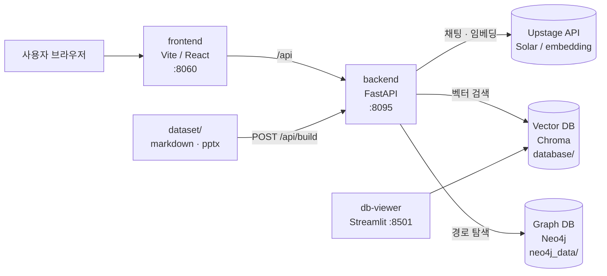

# OLM AI BOT 배포 가이드

새 서버에 처음 배포한다고 가정하고, 구성 → 설치 → 데이터 적재 → 확인 → 운영 순서로 정리한 문서입니다.

---

## 1. 전체 구성



| 컨테이너 | 역할 | 포트 |
|---|---|---|
| `olm-frontend` | 챗봇 화면 (현재 개발 모드: `npm run dev`) | `MAIN_PORT` (8060) |
| `olm-backend` | 챗봇 API (FastAPI). 질문 → 벡터 검색 + 그래프 경로 탐색 → Solar 답변 | `BACKEND_PORT` (8095), API 문서 `/docs` |
| `olm-neo4j` | 그래프 DB (프로세스 간 연결 관계) | 7474 (브라우저), 7687 (bolt) |
| `olm-db-viewer` | 벡터 DB 내용 확인용 Streamlit | 8501 (`/viewer`) |

### 사용하는 AI 모델 (Upstage)
| 용도 | 모델 | 설정 위치 |
|---|---|---|
| 답변 생성 · 질문 분류 · Cypher 생성 | `solar-pro2` (기본값) | `.env` 의 `MODEL_CHAT` 로 변경 가능 |
| 문서 임베딩 (DB 구축 시) | `embedding-passage` (4096차원) | `backend/app/core/config.py` |
| 질문 임베딩 (검색 시) | `embedding-query` (4096차원) | `backend/app/core/config.py` |

> 임베딩 모델을 바꾸면 **벡터 DB 를 반드시 다시 만들어야** 합니다. (차원·벡터 공간이 달라 기존 DB 로는 검색 불가)

---

## 2. 데이터는 어디에 무엇이 있나

git 에는 **원본 문서(`dataset/`)만** 들어 있고, DB 는 들어 있지 않습니다. 새 서버에서는 DB 를 만들어야 합니다.

| 구분 | 위치 | git 포함 | 내용 |
|---|---|---|---|
| **원본 문서** | `dataset/markdown/` | O | 프로세스 정의서 402개 (`Activity`, `Rule set`, `Sub Process`, `내부통제`, `실행과제`) |
| | `dataset/manual/` | O | 매뉴얼 PPT 2개 |
| **Vector DB** (Chroma) | `database/process_db/` | X | `process_collection` ← markdown 을 조각(약 1,200개)으로 나눠 임베딩 |
| | `database/project_db/` | X | `project_collection` ← pptx 텍스트를 임베딩 |
| **Graph DB** (Neo4j) | `neo4j_data/` | X | `(:Process {id, name, ...})-[:RELATED_TO {label}]->(:Process)` ← markdown 의 "연관항목" |
| **채팅 기록** | `database/chat_history.db` | X | SQLite. 세션/대화 기록 |

### 원본 문서 → DB 변환 방식
`POST /api/build` 를 호출하면 `backend/app/core/database.py` 의 `DBBuilder` 가 아래를 수행합니다.

1. **Neo4j 전체 노드 삭제** (`MATCH (n) DETACH DELETE n`)
2. Chroma `process_collection` 삭제 후 재생성
3. `dataset/markdown/**/*.md` 를 하나씩 읽어서
   - **Graph DB**: 문서 1개 = `Process` 노드 1개 (`id` = 문서의 Global Key), "연관항목" 마다 `RELATED_TO` 관계 생성
   - **Vector DB**: 섹션 단위로 조각을 나눠 Upstage `embedding-passage` 로 임베딩 후 저장
4. `dataset/manual/*.pptx` 텍스트를 1,000자 단위로 잘라 `project_collection` 에 저장

### 질문 처리 흐름 (참고)
1. 질문에서 두 대상 추출 (예: "A와 B는 어떻게 연결되어 있어?" → A, B)
2. Vector DB 에서 A, B 에 해당하는 문서 검색 → Global Key 확정
3. Solar 가 Cypher 생성 → Neo4j 에서 A→B 최단 경로 탐색 → 화면에 **빨간 선**으로 표시
4. 검색된 정의서 + 경로를 근거로 Solar 가 답변 생성

---

## 3. 처음 배포하기

### 3-1. 준비물
- Docker Desktop (Windows) 또는 Docker Engine + Compose (Linux)
- Upstage API 키 (https://console.upstage.ai/api-keys)
- 소스: `git clone https://github.com/lyn0310/OLM_AI_BOT.git`

### 3-2. `.env` 만들기
프로젝트 루트(`docker-compose.yml` 과 같은 위치)에 `.env` 생성. **git 에 올리지 않습니다.**

```env
# 포트
MAIN_PORT=8060
BACKEND_PORT=8095

# 키
UPSTAGE_API_KEY=up_xxxxxxxxxxxxxxxx
NEO4J_PASSWORD=원하는비밀번호

# 프론트엔드가 호출할 백엔드 주소 (브라우저 기준 주소)
VITE_API_URL=http://<서버주소>:8095/api

# (선택) 답변 모델 변경. 생략 시 solar-pro2
# MODEL_CHAT=solar-pro4
```

| 변수 | 설명 |
|---|---|
| `UPSTAGE_API_KEY` | 필수. 없으면 답변/검색 모두 실패 |
| `NEO4J_PASSWORD` | Neo4j 최초 기동 시 이 비밀번호로 계정 생성. **`neo4j_data/` 가 이미 있으면 기존 비밀번호가 유지**됨 |
| `VITE_API_URL` | 사용자 브라우저에서 접근 가능한 백엔드 주소. `localhost` 로 두면 다른 PC 에서 접속 시 동작 안 함 |
| `MODEL_CHAT` | 선택. 사용 가능한 모델 목록 확인: `curl https://api.upstage.ai/v1/models -H "Authorization: Bearer <키>"` |

### 3-3. 서버별로 바꿔야 하는 설정
`docker-compose.yml` 의 neo4j 항목:
```yaml
- NEO4J_server_bolt_advertised__address=sfolm.iptime.org:7687
```
→ 새 서버의 주소로 변경. (Neo4j 브라우저(7474)에서 접속할 때 쓰는 주소이며, 백엔드는 내부 주소 `bolt://neo4j:7687` 로 접속하므로 챗봇 동작에는 영향 없음)

### 3-4. 기동
```bash
cd /d D:\OLM_AI_BOT
docker compose up -d --build
```
또는 `ai_bot_python.bat` 실행 (기존 컨테이너 정리 → 빌드 → 기동 → 백엔드 로그 출력).

기동 확인:
```bash
docker compose ps
docker logs -f olm-backend
```
로그에 `[System] 챗봇 준비 완료` 가 보이면 정상. (이 시점에는 DB 가 비어 있어 질문하면 에러가 나는 것이 정상)

---

## 4. 데이터 적재 (둘 중 하나)

### 방법 A. 원본 문서로 새로 구축 (권장)
```bash
curl -X POST "http://localhost:8095/api/build?target=all"
```
- 소요 시간: **약 15~20분** (약 1,200개 조각을 하나씩 임베딩). 끝날 때까지 `curl` 이 대기하는 것이 정상
- 진행 확인 (다른 cmd 창):
  ```bash
  docker exec olm-backend python -c "import chromadb;print(chromadb.PersistentClient(path='/app/database/process_db').get_collection('process_collection').count())"
  ```
- 완료 시 로그: `[INFO] Build Complete! Total Chunks: 1206` (process), `... 14` (project)
- `target` 값: `all` | `process` (markdown + Neo4j) | `project` (pptx 만)
- Swagger 로 실행하려면 `http://localhost:8095/docs` → `POST /api/build`

**빌드 중 주의**
- 빌드 중에는 챗봇을 사용하지 마세요. 기존 DB 를 지우고 다시 만드는 중이라 `Collection does not exist` 에러가 납니다.
- `backend/` 아래 파일을 수정하지 마세요. 개발 모드(`--reload`)라 파일 변경 시 서버가 재시작됩니다.
- **Neo4j 데이터가 전부 삭제 후 재생성됩니다.** Neo4j 에 수동으로 넣은 데이터가 있다면 먼저 백업하세요.

### 방법 B. 기존 서버의 DB 를 복사
이미 구축된 서버가 있고 재구축 시간을 아끼고 싶을 때. **양쪽 서버의 임베딩 모델이 같아야** 합니다.

1. 기존 서버에서 컨테이너 중지 (파일 쓰기 중 복사하면 DB 가 깨질 수 있음)
   ```bash
   docker compose stop
   ```
2. 아래 폴더를 새 서버의 같은 위치로 복사
   - `database/` (Vector DB + 채팅 기록)
   - `neo4j_data/` (Graph DB, 약 500MB)
3. 새 서버에서 `docker compose up -d`
4. Neo4j 비밀번호는 **복사한 `neo4j_data` 의 비밀번호**가 유지되므로, 새 서버 `.env` 의 `NEO4J_PASSWORD` 를 기존 값과 맞춰야 합니다.

### (선택) Neo4j 인덱스
현재 운영 DB 에는 아래 인덱스가 있으나 코드가 자동으로 만들지 않습니다. 노드 수가 적어(약 700개) 없어도 동작하지만, 데이터가 늘면 생성을 권장합니다.
Neo4j 브라우저(`http://<서버>:7474`)에서 실행:
```cypher
CREATE INDEX process_id IF NOT EXISTS FOR (n:Process) ON (n.id);
CREATE INDEX process_display_id_idx IF NOT EXISTS FOR (n:Process) ON (n.display_id);
CREATE INDEX attr_id IF NOT EXISTS FOR (n:Attribute) ON (n.id);
CREATE FULLTEXT INDEX process_name_idx IF NOT EXISTS FOR (n:Process) ON EACH [n.name, n.id];
```

---

## 5. 배포 후 확인

| 확인 | 방법 | 기대 결과 |
|---|---|---|
| 백엔드 | `http://<서버>:8095/docs` | Swagger 화면 |
| Upstage 키 · 모델 전달 | `docker exec olm-backend python -c "import os;k=os.getenv('UPSTAGE_API_KEY','');print(k[:6] or 'EMPTY', os.getenv('MODEL_CHAT'))"` | `up_xxx solar-pro2` |
| Vector DB | 위 count 명령 | 1206 |
| Graph DB | Neo4j 브라우저에서 `MATCH (n:Process) RETURN count(n)` | 약 700 |
| 챗봇 | `http://<서버>:8060` 에서 "품목코드 통합 분류체계와 일반 BP 등록은 어떻게 연결 되어있어?" | 답변 + 지식 그래프에 **빨간 경로선** 표시 |

---

## 6. 운영

### 문서(데이터) 갱신
1. `dataset/markdown/`, `dataset/manual/` 의 파일 교체·추가
2. `POST /api/build?target=all` 재실행 (전체 재구축. 부분 갱신 기능은 없음)

### 키·모델 변경
`.env` 수정 후 컨테이너 재생성 (`restart` 로는 환경변수가 반영되지 않음):
```bash
docker compose up -d backend
```
임베딩 모델을 바꾼 경우에만 `POST /api/build` 재실행 필요. 답변 모델(`MODEL_CHAT`)만 바꾼 경우는 불필요.

### 백업 대상
`database/`, `neo4j_data/` (컨테이너 중지 후 복사). 원본 `dataset/` 은 git 에 있음.

---

## 7. 알아둘 제약 · 주의사항

- **Upstage 임베딩 입력 한도 4,000토큰**: 긴 조각은 앞 5,000자만 임베딩하도록 처리되어 있음 (`MAX_EMBEDDING_CHARS`, `backend/app/core/utils.py`). 원문 저장은 전체.
- **경로 탐색 조건**: 질문에 "경로·흐름·순서·단계·부터·까지·최단" 이 있거나, "A와 B는 어떻게 연결/관계" 형태일 때만 경로(빨간 선)를 탐색합니다.
- **현재 compose 는 개발 모드**입니다. (frontend `npm run dev`, backend `--reload` + 소스 볼륨 마운트)
  운영 모드(`docker-compose.yml` 의 "[옵션 2] 배포 모드" + `nginx-proxy`)로 전환하려면 `nginx/default.conf` 를 먼저 손봐야 합니다. 현재 nginx 설정은 예전 Spring Boot 백엔드 기준(`/swagger-ui` 등)으로 되어 있습니다.
- `backend_boot/` (Spring Boot 백엔드)는 현재 사용하지 않습니다.
